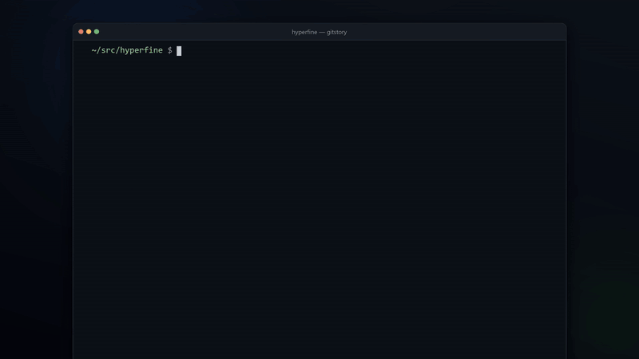
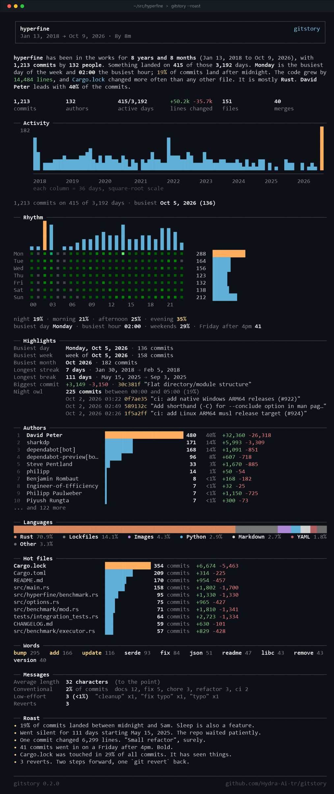
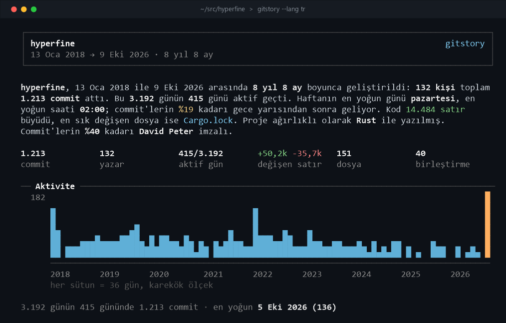
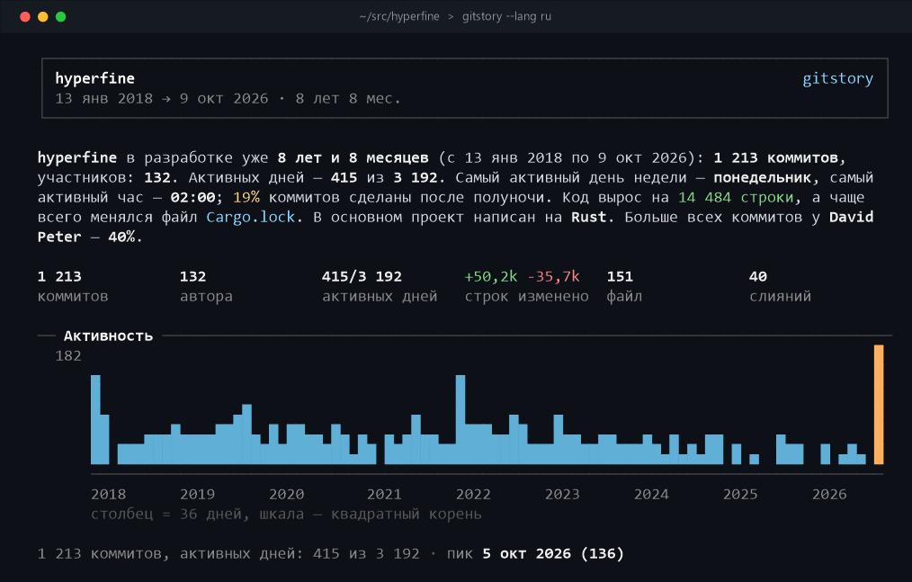
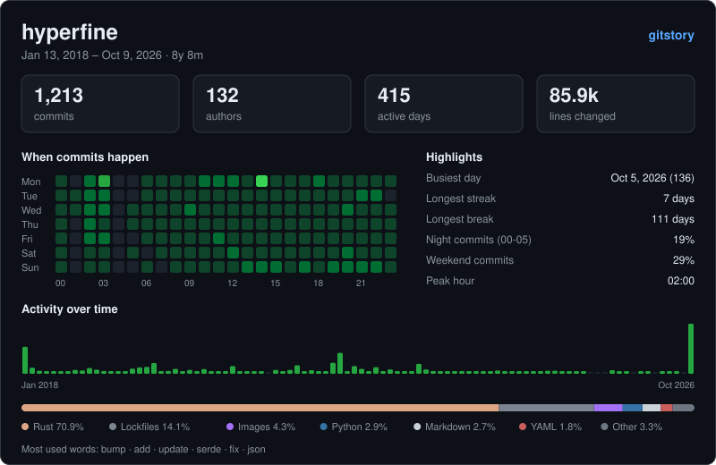

# gitstory

**The story of a git repository, told in your terminal.**

`gitstory` reads a repository's history and turns it into a report you can actually read:
a short narrative, an activity chart, the week's rhythm, highlights, the people behind the
code, languages, hot files, commit-message habits and, if you ask for it, a gentle roast.
It can also export everything as JSON or as a shareable SVG card. Reports are available in
**English, Turkish and Russian**.

<p align="center">
  <a href="https://github.com/Hydra-Ai-tr/gitstory/releases/download/v0.2.0/gitstory-intro-en.mp4">
    
  </a>
  <br>
  <sub>
    One-minute tour:
    <a href="https://github.com/Hydra-Ai-tr/gitstory/releases/download/v0.2.0/gitstory-intro-en.mp4">English</a> ·
    <a href="https://github.com/Hydra-Ai-tr/gitstory/releases/download/v0.2.0/gitstory-intro-tr.mp4">Türkçe</a>
  </sub>
</p>

<p align="center">
  
</p>

## Features

- **Story first.** A plain-English summary of the project: how long it has been going, who
  leads it, when people work and what it is written in.
- **Activity that fits the history.** A day-by-day chart for young repositories, a
  GitHub-style calendar for the last year and a compressed timeline for long-lived projects.
- **Rhythm.** Commits per hour and per weekday, with an hour × weekday heat map.
- **Highlights.** Busiest day, week and month, longest streak and break, the biggest commit,
  late-night commits.
- **Authors and languages.** Ranked contributors (aliases with the same name are merged) and
  a stacked language bar based on lines changed.
- **Hot files, words and messages.** Most-changed files, most common words in commit
  subjects, Conventional Commit usage and low-effort messages.
- **`--roast`.** A light-hearted take on the repository's habits.
- **Your language.** English, Turkish and Russian, with local number and date formats and
  proper plural forms. The system language is picked up automatically.
- **Exports.** `--json` for scripts, `--svg` for a README-ready card (dark or light).
- **Works everywhere.** Adapts to the terminal width, honours `NO_COLOR`, and picks glyphs
  your terminal can draw: full Unicode, a classic-Windows-console-safe set, or pure ASCII.
- **One small binary.** No runtime dependencies besides `git` itself.

## Install

### Windows

Download `gitstory-<version>-windows-x64.zip` from the
[latest release](https://github.com/Hydra-Ai-tr/gitstory/releases/latest), unzip it and put
`gitstory.exe` somewhere on your `PATH`. The executable is statically linked; it only needs
[Git for Windows](https://git-scm.com/download/win).

### From source (any platform)

You need CMake 3.16+, a C++17 compiler and `git`.

```sh
git clone https://github.com/Hydra-Ai-tr/gitstory.git
cd gitstory
cmake -S . -B build -DCMAKE_BUILD_TYPE=Release
cmake --build build
ctest --test-dir build --output-on-failure   # optional
cmake --install build                        # optional
```

## Usage

```sh
gitstory                       # the repository you are standing in
gitstory ~/src/project --roast
gitstory --since "1 year ago" --no-merges
gitstory --author "ada" --top 5
gitstory --json > stats.json
gitstory --svg card.svg        # add --light for the light theme
gitstory --lang tr             # Türkçe rapor
```

```
Usage: gitstory [path] [options]

  path                  Repository to analyse (default: current directory)

Selecting history:
      --rev <rev>       Branch, tag or range to walk (default: HEAD)
      --all             Walk every branch and tag
      --since <date>    Only commits after this date   (e.g. 2024-01-01, "1 year ago")
      --until <date>    Only commits before this date
      --author <text>   Only commits whose author matches
      --no-merges       Leave merge commits out
  -n, --max-count <n>   Stop after the newest <n> commits

Output:
      --lang <lang>     auto, en, tr or ru (default: the system language)
      --roast           Add a light-hearted roast of the repository
      --json            Print every statistic as JSON
      --svg <file>      Write a shareable SVG card ('-' for stdout)
      --light           Use the light theme for the SVG card
      --top <n>         Rows per ranking (default: 10)
      --width <n>       Report width in columns (default: terminal width)
      --color <when>    auto, always or never (default: auto; honours NO_COLOR)
      --glyphs <set>    auto, full, basic (classic Windows console) or ascii
      --ascii           Same as --glyphs ascii

  -h, --help            Show this help
  -V, --version         Show the version
```

### Languages

`--lang` chooses the language of the report, the help text, the SVG card and the roast:
`en` (English), `tr` (Türkçe) or `ru` (Русский). Without it (or with `--lang auto`),
`gitstory` looks at `GITSTORY_LANG`, then `LC_ALL`, `LC_MESSAGES` and `LANG`, and on Windows
at the display language; anything else falls back to English.

Numbers, dates and plurals follow the language: `1,213 commits` / `1.213 commit` /
`1 213 коммитов`, `Oct 5, 2026` / `5 Eki 2026` / `5 окт 2026`.

<p align="center">
  
  
</p>

### SVG card

<p align="center">
  
</p>

### Glyphs

`--glyphs auto` (the default) uses the full Unicode set, with eighth-block bars and rounded
corners, in modern terminals such as Windows Terminal, VS Code, WezTerm, iTerm2 and most
Linux terminals. In the classic Windows console, whose fonts lack those characters, it
switches to `basic`. Use `--glyphs ascii` for logs or anything that is not UTF-8.

### JSON

`--json` prints a single object with these top-level keys:
`gitstory_version`, `language`, `repository`, `totals`, `span`, `rhythm`, `highlights`, `authors`,
`top_files`, `file_types`, `languages`, `top_words`, `messages`, `daily` and `roast`.
Keys, dates and numbers are the same in every language; only `roast` is translated.

## How it works

`gitstory` runs `git log --numstat` once, streams the output through a small parser and
aggregates everything in a single pass. Nothing is written to the repository and nothing
leaves your machine.

## License

[MIT](LICENSE)
